# qsmbly UI redesign plan

Status: accepted 2026-10-16, with every recommendation in §7. It settles how the steps that the
[parity plan](qsmxt-parity-plan.md) holds back for the redesign are built: 3.4 (mask builder),
3.5 (re-run from here), 3.6 (plan before running), 4.2 (settings renderer) and the UI side of
phase 5. It also lists what the engine has to provide for them.

Revised 2026-10-16, during U3: the settings sit inline in the pipeline column instead of in an
inspector on the right (§3.3, §3.5, §7 Q1). The three-pane layout made the eye cross the page
between choosing a step (far left) and editing it (far right). The mask builder's editor moved
into U3; its engine-backed previews stay in U5.

Sources:

- Screenshots of `main` @ 8d685b0 (QSMxT engine d5b71c6, QSM.rs 8a3afda), taken with a threaded
  SIMD build in headless Chrome at 1280×800, using the example dataset. The DICOM screens use a
  synthetic two-echo DICOM series written from the same public example data.
- The engine API on QSMxT main ec2825d, plus the step 2.3 PRs (QSMxT #337–#339, which are open
  and may change).
- QSMxT's TUI on ec2825d.

## Summary

1. **One workspace: the pipeline beside the viewer.**
   - The **pipeline column** on the left is the plan as an accordion of steps in run order.
     Each step's settings, rendered from the engine's schema, open inline under it. It is at
     once the settings, the plan and the run's progress.
   - The **viewer** takes the rest of the width, with an outputs browser under it in which every
     intermediate is first-class.
   - A **run bar** across the bottom. It carries the plan (memory against the 4 GB heap,
     model downloads, problems) and the Run / Re-run / Cancel button.
2. **The session is a `PipelineConfig` plus inputs.**
   - Every edit re-plans, which is cheap, and the engine's cache keys mark the steps it makes
     stale. Run recomputes only those steps.
   - What is exported is the same config: TOML, its `qsmxt run` command and its methods text,
     all generated by the engine. The UI keeps no parameters of its own.
3. **The mask is a pipeline step.**
   - The mask builder edits the engine's mask recipe. Its previews come from the engine's own
     masking.
   - Hand edits and uploads become a supplied mask. It is exported as a BIDS derivative, so
     `qsmxt run --use-custom-masks` reproduces the run.
4. **Settings come only from the schema.**
   - Sections follow QSMxT's TUI tabs.
   - Whether a setting is basic or advanced, and whether it is shown, comes from the engine.
   - Defaults are the engine's browser profile.
5. **Build it as a second app in the repo**, behind `next.html` on staging, on the engine
   bindings (3.1/3.2).
   - Keep today's UI only working until the new one covers it.
   - Then switch in one release, and delete the old UI together with its JS numerics and
     hand-written settings.
6. **Technology.**
   - Keep static ES modules with no bundler.
   - Add Preact + htm + signals, vendored (about 10 KB).
   - Keep NiiVue, upgraded and loading typed arrays.
   - Keep every volume in a main-thread store as float32 in SharedArrayBuffers. That is outside
     the 4 GB WASM heap, at the same precision as QSMxT's intermediates, and cancelling a run
     never loses finished steps.
7. **The engine needs additions first (§4).**
   - Labels and units for steps and outputs.
   - Per-step plan details.
   - Requirement problems that are not worded for the CLI.
   - Config normalisation inside the engine.
   - A ScanFacts builder.
   - Mask-preview semantics.
   - Methods and command wording for a supplied mask.
   - The schema's UI fields.

The decisions needed are in §7.

## 1. Today's UI

### 1.1 Screens and flows

| Flow | What happens | Screens |
|---|---|---|
| Start | There is a landing page, then the app at `#app`. The sidebar is an accordion of five sections (Input files, Input parameters, Masking, Supplementary images, QSM pipeline), with export buttons and a status bar. Next to it are the viewer and a console. A welcome prompt offers a 7-step tour. | 1 |
| Load data | One drop zone takes NIfTI, JSON or DICOM files and folders. Files are sorted into Magnitude / Phase / Total field / Local field / JSON / Uncategorized buckets, which can be reassigned by dragging. Echo times come from sidecars, and field strength from the sidecar or DICOM. | 2 |
| DICOM | dcm2niix runs in the browser and fills the same buckets. dicompare produces a protocol report against the QSM consensus schema. | 3, 4 |
| Mask | Pick a masking input, then **Prepare Input**. Then use Threshold (Robust or Manual), BET, HD-BET or Mouse, each with its own dialog. Refine with fill holes, erode, dilate, signal erode or the paint brush. Custom masks can be uploaded, with alignment repair. | 5, 6, 7 |
| Pipeline | The sidebar has four dropdowns: pipeline, unwrapping, background, inversion. **Advanced** opens a modal with five tabs and an explicit Save. **Start QSM** runs it. | 8, 9, 10 |
| Run | The status bar shows progress text and a bar. Each stage is sent to the viewer as it finishes, and the console logs the run. | 11, 12 |
| Results | A flat list of stage buttons, each with a download. Viewer controls cover window, colormap, colorbar, crosshair and screenshot. | 13 |
| Supplementary | SWI and T2*/R2* run as separate jobs from their own buttons, with SWI settings in another modal. | 14 |
| Export | A modal with Command, Methods and a TOML download, all generated by qsmxt-engine through WASM. | 15 |
| Mobile | A tab bar switches between Controls, Viewer and Console. | 16 |

<table>
<tr><td><a href="ui-redesign/today-01-empty.png">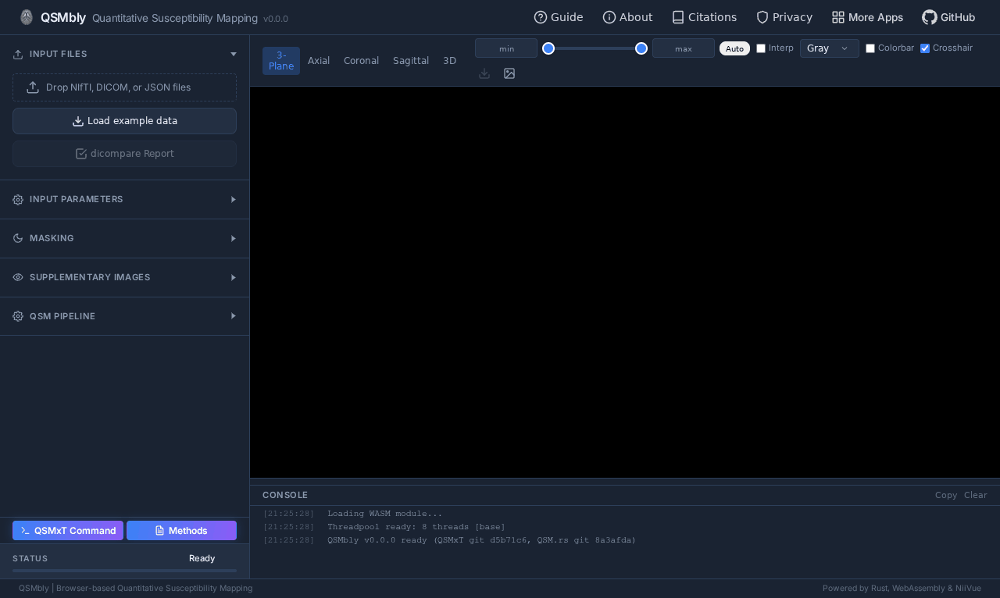</a><br>1. Empty workspace</td><td><a href="ui-redesign/today-02-files.png">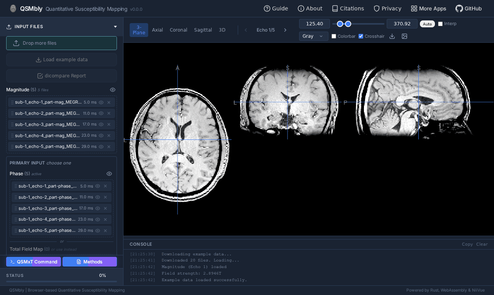</a><br>2. Files sorted into buckets</td><td><a href="ui-redesign/today-03-dicom.png">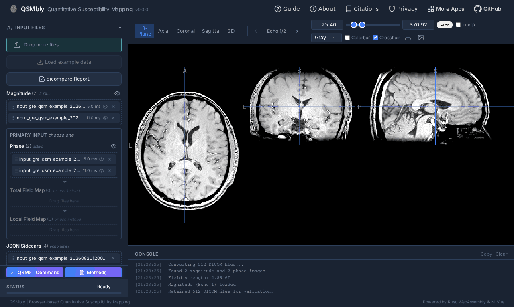</a><br>3. DICOM converted</td><td><a href="ui-redesign/today-04-dicompare.png">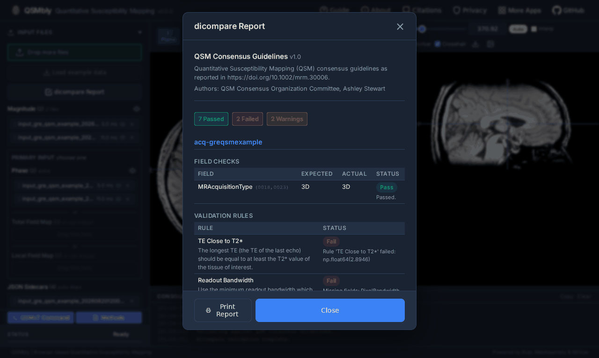</a><br>4. dicompare report</td></tr>
<tr><td><a href="ui-redesign/today-05-mask-phase-quality-error.png"></a><br>5. Prepare Input fails (phase quality)</td><td><a href="ui-redesign/today-06-mask-refine.png">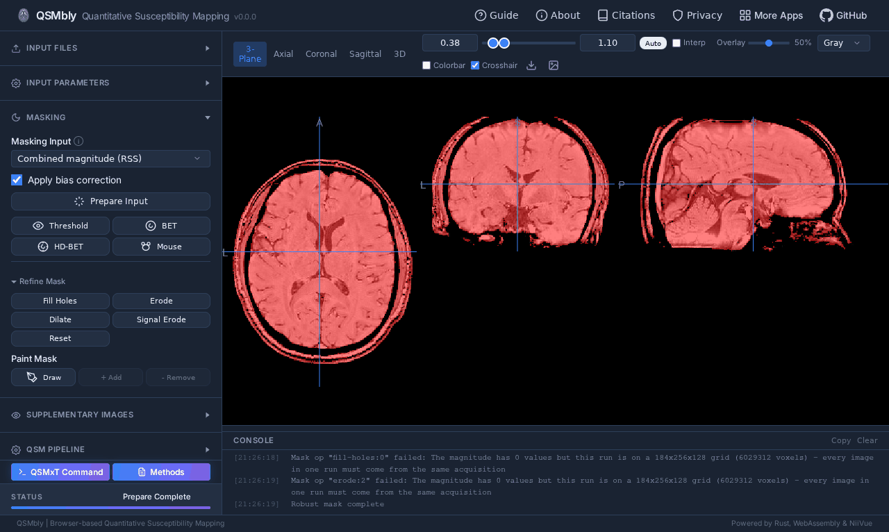</a><br>6. Threshold mask; refinements failed</td><td><a href="ui-redesign/today-07-hdbet-dialog.png">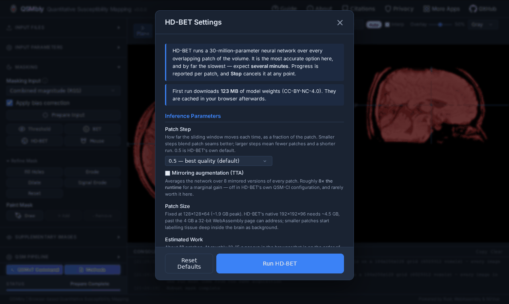</a><br>7. HD-BET dialog</td><td><a href="ui-redesign/today-08-pipeline-sidebar.png">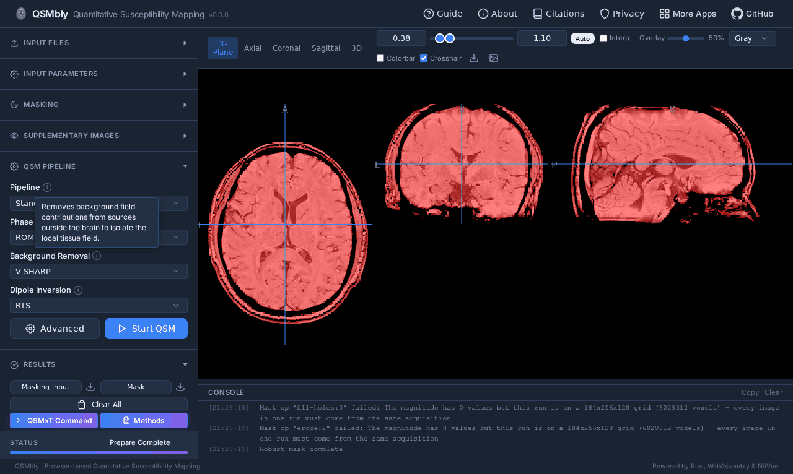</a><br>8. Pipeline in the sidebar</td></tr>
<tr><td><a href="ui-redesign/today-09-settings-modal.png">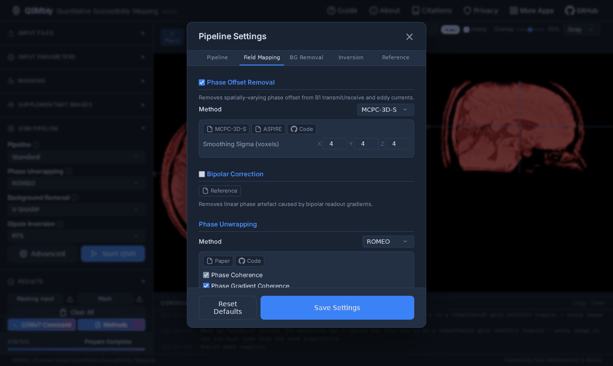</a><br>9. Settings modal</td><td><a href="ui-redesign/today-10-settings-dl.png">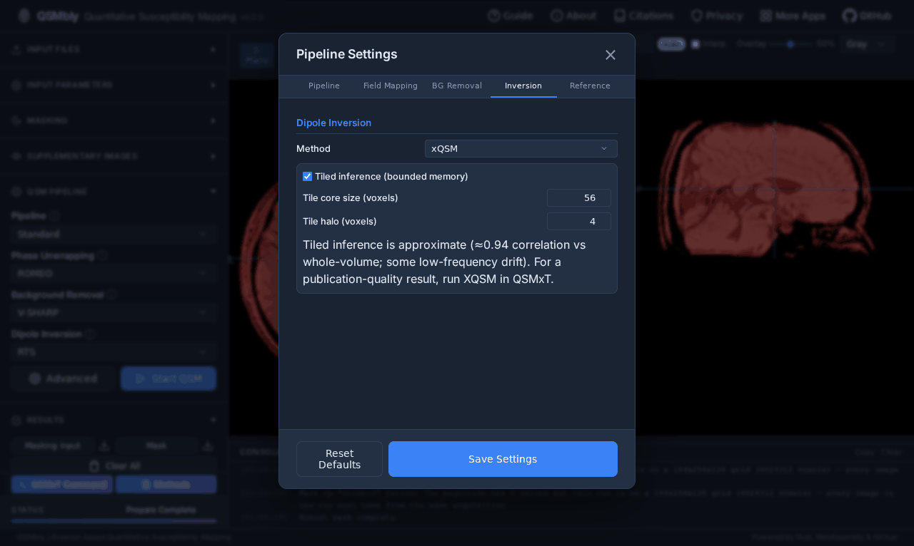</a><br>10. DL inversion settings</td><td><a href="ui-redesign/today-11-running.png">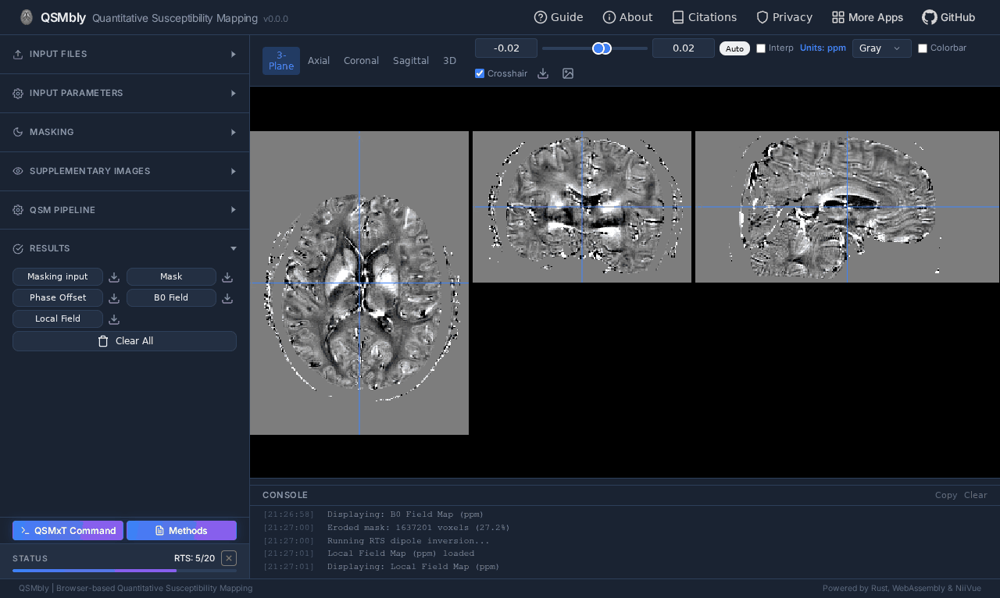</a><br>11. Running: local field streamed</td><td><a href="ui-redesign/today-12-dl-running.png">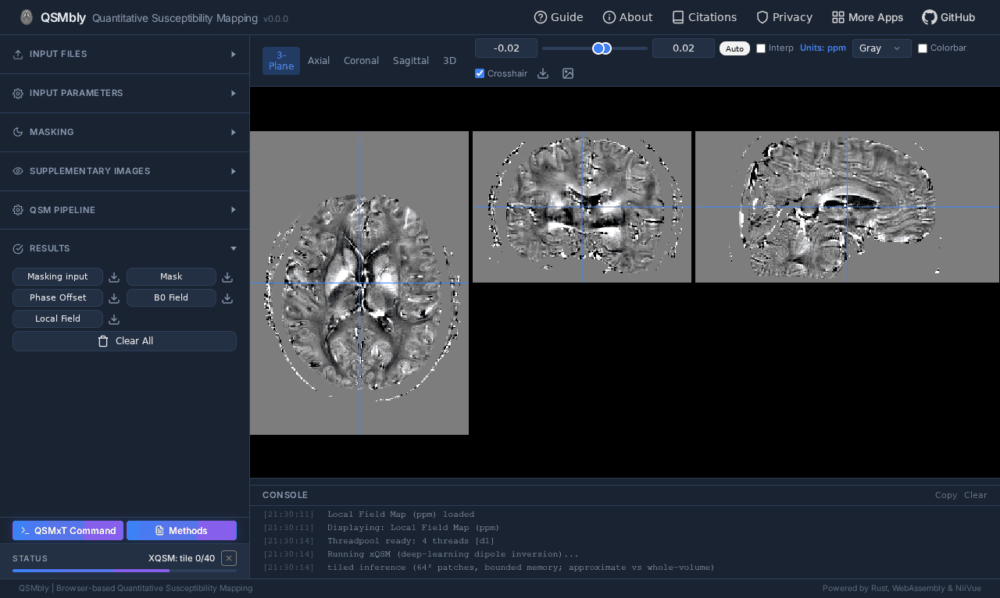</a><br>12. xQSM running ("tile 0/40")</td></tr>
<tr><td><a href="ui-redesign/today-13-results.png">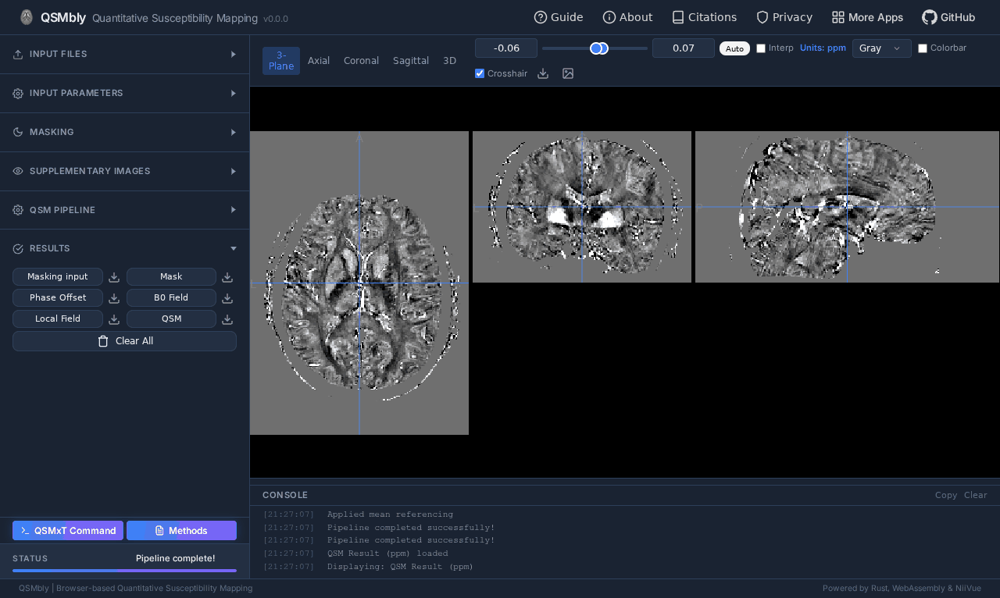</a><br>13. Results list</td><td><a href="ui-redesign/today-14-supplementary.png">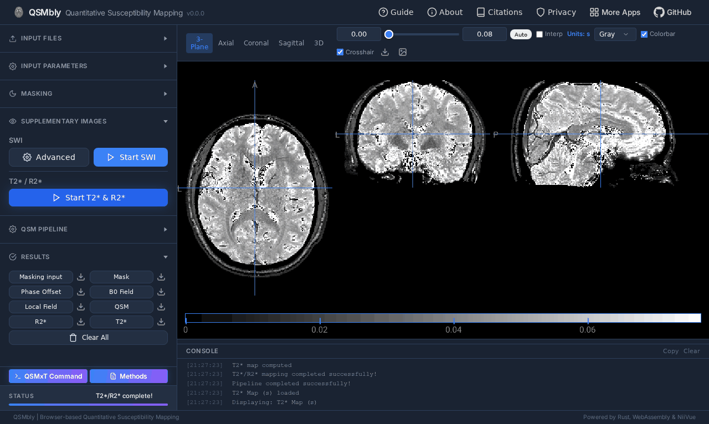</a><br>14. T2*/R2* as a separate job</td><td><a href="ui-redesign/today-15-export.png">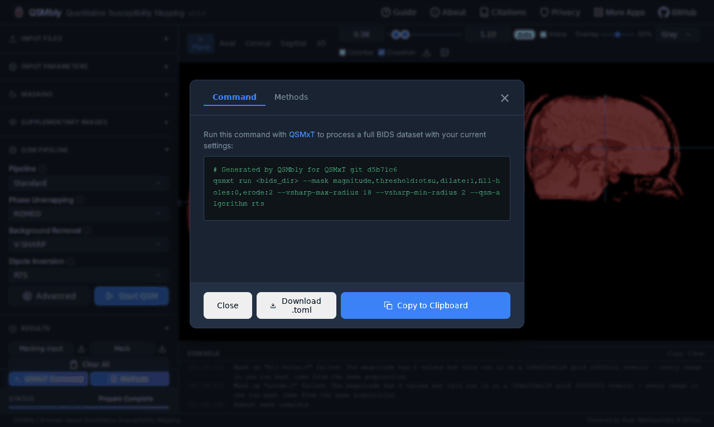</a><br>15. Export modal</td><td><a href="ui-redesign/today-16-mobile.png">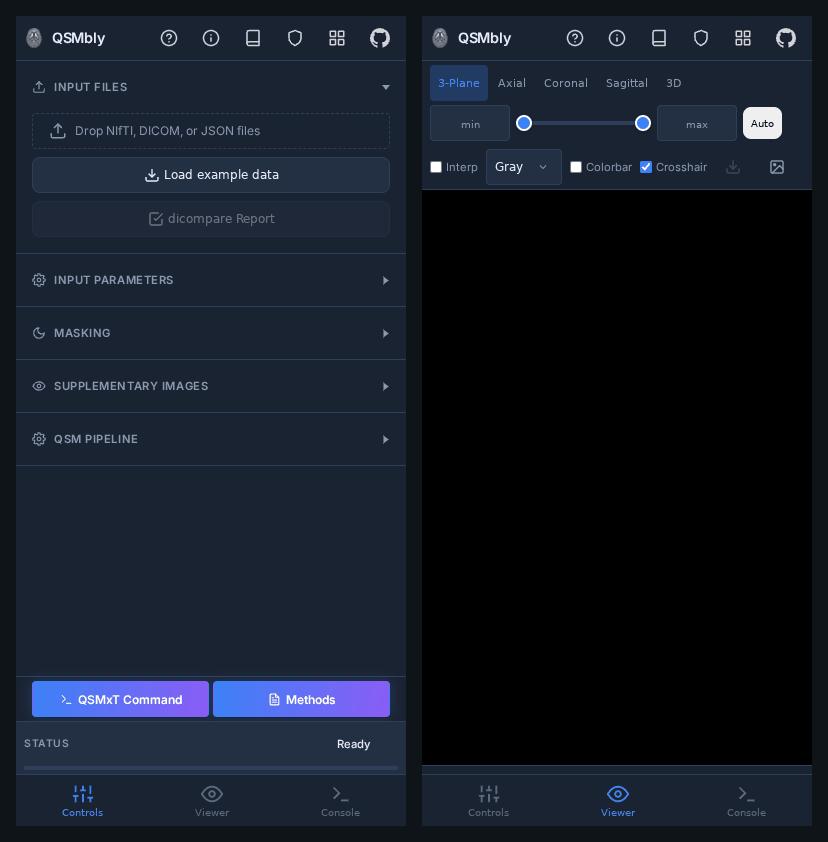</a><br>16. Mobile: controls and viewer</td></tr>
</table>

### 1.2 What works, and should carry over

- One drop zone for everything, with sorting into buckets and manual reassignment.
- DICOM conversion in the browser.
- The dicompare report.
- One-click example data.
- Outputs streamed to the viewer as stages finish.
- Downloads for each stage.
- The HD-BET dialog states the cost, licence and memory before running. Every deep-learning
  choice should be presented this way.
- Upload alignment repair: it previews first, then the user applies.
- Command and methods text from qsmxt-engine.
- QSMxT and QSM.rs versions in About.
- The privacy page.
- The accessibility work already done: dialog focus management, labelled inputs and keyboard
  accordions.

### 1.3 What is confusing or broken

1. **The order of work is implicit and enforced late.**
   - Start QSM stays disabled until a mask exists. In raw mode, `updateEchoInfo()` requires
     `currentMaskData`. Nothing on screen says so.
   - Making that mask takes at least four clicks: open Masking, Prepare Input, Threshold, then
     Robust or Manual.
   - In QSMxT the mask is a pipeline step with a default recipe.
2. **The export records clicks, not what ran.**
   - Each mask click is appended to `maskOpsHistory` and becomes a `--mask` string
     (`maskSectionString`).
   - On main today every refinement fails (`Mask op "dilate:1" failed: The magnitude has 0
     values…`), and the console then reports "Robust mask complete".
   - The export still says `--mask magnitude,threshold:otsu,dilate:1,fill-holes:0,erode:2`, and
     the methods text says "followed by dilation, hole-filling, and erosion". The mask actually
     used is the bare threshold, scalp included (screens 6 and 15).
   - #46 (BET erosions missing from the record) was the same class of bug.
   - SWI and T2* enter the exported config only if their result files exist
     (`buildConfigJson(…, { doSwi: !!this.results?.swi?.file })`).
3. **The default masking path is broken on main.**
   - Prepare Input with the default "Phase quality map" throws
     `Failed to execute 'postMessage' on 'Worker'` (screen 5).
   - Cause: `computeVoxelQualityMap` puts `phase1.buffer` in the transfer list, but `phase1` is
     now a `{data, header}` volume.
   - The refinement failure in item 2 has a related cause: the worker's `runApplyMaskOps` now
     requires a full-size magnitude even for ops that do not read one.
   - Both arrived with the grid checks (#150, 3b7d9ca). They are worth fixing now, independently of
     this plan.
4. **Settings live in three places, under names that differ from QSMxT's.**
   - The places: the sidebar dropdowns, the five-tab modal with its explicit Save, and the
     per-generator dialogs (BET, HD-BET, Mouse, SWI).
   - The UI says "MCPC-3D-S" where the methods text it exports says "HIP method".
   - BET has a "Number of Erosions" parameter. QSMxT has no such BET parameter; erosions are
     separate steps.
   - TGV offers "Regularization Level 1–4" where QSMxT has an α pair.
   - V-SHARP radii are derived from the voxel size (18→2 mm) where QSMxT uses 12→1 mm.
   - About 3,300 lines restate QSMxT's parameters by hand: about 1,300 lines of settings HTML,
     `PipelineSettingsController.js` (1,255), `ConfigBridge.js` (252) and `config.js` (513).
   - Coverage is partial: about 180 controls, against 311 settings in QSMxT's TUI.
5. **Requirement rules are re-implemented and drift.**
   - "Requires magnitude", "Requires multi-echo data" and "T2*/R2* mapping requires 3+ echo
     magnitudes" are written by hand in JS, in `updateVisibility()`, `updateEchoInfo()` and
     the worker.
   - #145 (a ppm field map passes the run gate, then fails in the worker) is one instance of
     the drift.
   - QSMxT's `requirements.rs` is the authority on these rules.
6. **Results are a flat list** (screens 13 and 14).
   - It mixes mask-builder products (Masking input, Mask), pipeline outputs and supplementary
     outputs.
   - It records nothing about which settings produced each output.
   - A new run replaces the old outputs, and there is no comparison.
   - Display ranges are set per stage, ad hoc.
7. **Costs appear late.**
   - Deep-learning weights download in the middle of a run: "Preparing xQSM weights (~21 MB…)"
     appears in the console.
   - Memory is mentioned only in prose (the DL tiling note, the HD-BET dialog).
   - There is no estimate before running.
   - The status line can sit still for long stretches. xQSM showed "tile 0/40" in every sample
     taken (screen 12).
8. **The layout gets in the way.**
   - Only one accordion section is open at a time, so files and mask cannot be seen together.
   - Info tooltips are hover-only, so keyboard and touch users cannot reach them (screen 8).
   - The viewer toolbar wraps at 1280 px.
   - The export buttons are enabled before any data is loaded.
   - There is only a dark theme.
   - The console is the main feedback channel.
9. **Cancel discards the worker and everything in it.** Nothing resumes
   (`PipelineExecutor.cancel`).
10. **Field-map inputs (total or local) are qsmbly-only.** QSMxT has no such input, so the
    exported command cannot reproduce these runs.

### 1.4 What the engine replaces

| Area | Today (lines) | Duplicates | Replaced by |
|---|---|---|---|
| Pipeline wiring | `qsm-worker-pure.js` (1,976) | QSMxT's stage wiring | `plan`/`run` (2.3) |
| Settings | settings HTML (~1,300), `PipelineSettingsController.js` (1,255), sidebar dropdowns | QSMxT config and TUI rows | settings rendered from the schema, inline in the pipeline (4.1/4.2) |
| Config mapping | `ConfigBridge.js` (252), `config.js` (513), generated `qsm-defaults.js` (283) | `PipelineConfig` and its defaults | session state *is* a `PipelineConfig`; browser profile (2.5) |
| Requirement rules | `updateVisibility`, `updateEchoInfo`, worker checks | `requirements.rs` | `plan().check` |
| Mask building | numerics in `MaskController.js` (threshold, RSS, prepare), `ThresholdUtils` (103), `MaskUtils` (63), `RodentMask` (120), `HdBetEstimate` (50), op history → `--mask` string | QSM.rs masking, QSMxT mask recipes | mask recipe in config, engine mask step and previews |
| Phase / field numerics | `PhaseUtils` (163), `FilterUtils` (82), `TgvParams` (44), `ScanParams` (58), `DlTiling` (31) | qsm-core, engine | engine stages |
| Output names and display | `STAGE_DISPLAY_NAMES`, worker descriptions | engine `Item`s | `Item` metadata from the engine |

qsmbly keeps these:

- File loading and classification (`FileIOController`, `NiftiUtils`, `ImageClassification`).
- DICOM (`DicomController`, dcm2niix) and dicompare.
- The NiiVue viewer.
- The brush tools.
- Mask alignment repair (`MaskAlignment`).
- Model download and caching (`ModelWeights`).
- The landing, About and Privacy pages.

## 2. What the engine makes possible

| Capability | Engine | What the UI does with it |
|---|---|---|
| **Plan before run** | `plan(config, facts) -> Plan { steps, models, peak_memory_bytes, check, notes, two_pass, motion_corrected }` (#338/#339) | The pipeline shows the steps that will run; the default is `load scale_phase magnitude mask motion unwrap bgremove invert reference output_space`. The run bar shows peak memory against the budget, plus the models to download with sizes from QSM.rs's registry (`find_model(id).files[].bytes`, e.g. xQSM 21 MB, HD-BET 123 MB CC-BY-NC). Requirement errors and warnings appear before any compute. |
| **Streamed outputs** | `Observer::output(&Item, VolumeRef)` on every `put` | The viewer follows the run. Combined magnitude, mask, total field, local field, raw χ, χ and QSMART's five intermediates are all there as they are produced. |
| **Progress per step** | `Observer::stage(step, algorithm, Started(text) \| Cached \| Finished(label))`, `progress(done, total)` | Each pipeline row shows its status and a progress bar. A cached step says so. |
| **Re-run from here** | Cache keys (`step_cache_key`), `graph::downstream_of`, store semantics (a changed key recomputes that step and everything downstream) | Edits mark steps stale. The button reads "Re-run 2 steps". The previous outputs stay for comparison. |
| **Mask recipes with previews** | `MaskSection` / `MaskOp` / `MaskRecipe`, `mask_presets()`, `stages::mask`, `run_step`; QSM.rs `resolve_masking_input` + `apply_mask_ops` (cheap for threshold and morphology) | A recipe editor whose previews are computed by the code the run uses. |
| **Settings from the schema** | 4.1 (planned) | Settings are always in step with QSMxT: the TUI's labels and help, and new QSMxT options appear without qsmbly changes. |
| **Exports identical to QSMxT** | `generate_command`, `generate_methods_for(config, "qsmbly")`, `to_toml_selected`, `from_toml_migrating` | An export panel, and import of a QSMxT TOML. |
| **Reproducibility** | A session is a `PipelineConfig` plus inputs (plus a supplied mask) | A qsmbly run *is* a `qsmxt run` command. |
| **Phase 5** | New stages appear in `plan` and in the schema | Per feature, the UI only adds display hints and the odd custom widget (region picker, statistics table). |

What the engine does not do yet is in §4. The large items:

- No labels on steps or outputs.
- Requirement messages worded for the CLI.
- No cancellation.
- Host steps that `MemoryStore` cannot run: SWI, SMWI, T2*/R2*, R2/R2′, χ-separation,
  SynthSeg, statistics, motion, and resampling back.
- A memory estimate that models a disk-backed run.

## 3. Proposed design

### 3.1 Principles

- **One source of truth.** A session is its inputs plus a `PipelineConfig`. A setting the
  config cannot hold does not exist in the UI.
- **The engine decides and the UI shows.** The engine says what runs (plan), what the data can
  produce (check), what changed (keys), what things are called (schema) and how to describe it
  (methods).
- **Settings and results side by side.** No modal stands between changing a setting and seeing
  what it does.
- **Every output stays inspectable.** Nothing is silently replaced.
- **Defaults that run.** The first run needs no settings: QSMxT's defaults plus the browser
  profile.
- **Cost before it is paid.** Show memory, downloads and licences before the button is pressed.

### 3.2 Information architecture

```
Session
├─ Inputs   files + roles  →  ScanFacts (header + sidecar + user overrides)
├─ Config   PipelineConfig (browser profile + changes)     undo/redo, import/export TOML
├─ Plan     engine.plan(config, facts) — derived, recomputed on every change
├─ Runs     run n: config snapshot, plan, step states, log, timings
└─ Store    volumes by Item + step keys, shared by runs (cached steps are reused)
```

The pipeline column lists the run's steps in order, following the TUI's tabs and sub-tabs. Each
row shows its current choice and the plan's state:

| TUI tab › sub-tab | Pipeline row | Plan steps | Typical outputs |
|---|---|---|---|
| Input | **Data** (files, roles, scan facts) | load, scale_phase | phase and magnitude per echo |
| Preprocessing › Geometry | Geometry | (resampling inside load / output_space) | — |
| Preprocessing › Masking | **Masking** | magnitude, mask, mask-reliable | combined magnitude, brain mask, reliable mask |
| Preprocessing › Motion | Motion | motion | corrected echoes |
| QSM › Field map | Field map | unwrap | total field (ppm, Hz) |
| QSM › Background | Background | bgremove(-reliable) | local field, its mask |
| QSM › Inversion | Inversion | invert / tgv / qsmart (-reliable), twopass | raw χ, QSMART intermediates |
| QSM › Reference | Reference | reference(-singlepass) | χ, χ support |
| χ-separation | χ-separation | chi_separation | χ+, χ−, χtotal |
| Other outputs › SWI/SMWI, Relaxometry, Segmentation | SWI/SMWI, Relaxometry, Segmentation | swi, smwi, t2star_r2star, r2_r2prime, segmentation, analysis | SWI, mIP, T2*, R2*, R2, R2′, labels, statistics |
| Execution | Performance (threads, memory kept for earlier runs), in the run bar | — | — |
| Methods | **Export**, in the header | — | methods, command, TOML, files |

- A step the plan does not run has no row: choosing TGV, which removes the background itself,
  takes Background removal out of the pipeline.
- Optional outputs (χ-separation, SWI/SMWI, relaxometry, segmentation, and motion correction)
  are rows with a switch. Turning one on adds its steps to the plan. Compute QSM is the switch
  on the Dipole inversion row.
- Multi-orientation is out of scope (single run), so it has no row. Neither has DICOM export
  (Other outputs › Export), which the parity plan leaves open.

### 3.3 Layout

Desktop (≥900 px). Numbers in the wireframes are illustrative.

```
+--------------------------------------------------------------------------------------------+
| QSMbly  5 echoes · 2.89 T · 184×256×128             [Undo] [Redo] [Theme] [Export v] [?]   |
+--------------------------------------+-----------------------------------------------------+
| [ Search settings                  ] | [3-plane v]  χ                  -0.10 … 0.10 ppm   |
| > Data            5 echoes · 2.89 T *|                                                     |
| > Geometry                 acquired *|                                                     |
| > Brain mask       robust-threshold *|                                                     |
| > Motion correction           off o [ ]                                                  |
| > Field map                   ROMEO *|              viewer (NiiVue)                       |
| v Background removal        V-SHARP *|                                                     |
|     BG Removal      [V-SHARP     v]  |                                                     |
|     Variable-kernel SHARP  Reference |                                                     |
|     Max Radius  (i)  * [  10 ] mm  ⟲ |                                                     |
|     Min Radius  (i)    [   1 ] mm    |                                                     |
|     + 3 advanced                     |                                                     |
| > Dipole inversion  62% [##   ]  [x] |-----------------------------------------------------|
| > Reference                    mean *| OUTPUTS  magnitude  mask  field  local field  χ     |
| OPTIONAL OUTPUTS                     |                                                     |
| > χ-separation                off o [ ]                                                  |
| > SWI / SMWI                  off o  |                                                     |
+--------------------------------------+-----------------------------------------------------+
| [Run]  Plan: 10 steps | peak 1.8 / 4.0 GB [####    ] | downloads: none | no problems | Log |
+--------------------------------------------------------------------------------------------+
```

- **One row per setting**, label left and control right: small number fields with the unit
  beside them, three small fields for a vector, compact selects and switches. Help sits behind
  an ⓘ and opens one line under the row. A value changed from its default carries a dot, with a
  reset on hover. Notes (forced on, browser default, out of range) are muted lines under the
  row.
- **One step open at a time.** Its basic settings show first, then "+ n advanced".
- **Light and dark** follow the system, or the header's theme button.

Small screens (<900 px): the viewer on top, the pipeline under it, the run bar always visible.

```
+----------------------+
| QSMbly  [Undo][Redo] |
|   viewer             |
| OUTPUTS  χ  mask ... |
| [ Search settings  ] |
| > Data               |
| v Field map    ROMEO |
|   Unwrapping [ROMEO] |
| ...                  |
| [Run] Plan: 10 steps |
+----------------------+
```

The workspace as built in U3 (recorded plans; the viewer shows a synthetic head until U2):

<a href="ui-redesign/u3-workspace-light.png">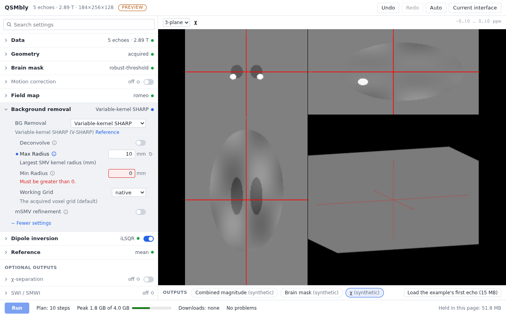</a>
<a href="ui-redesign/u3-workspace-dark.png">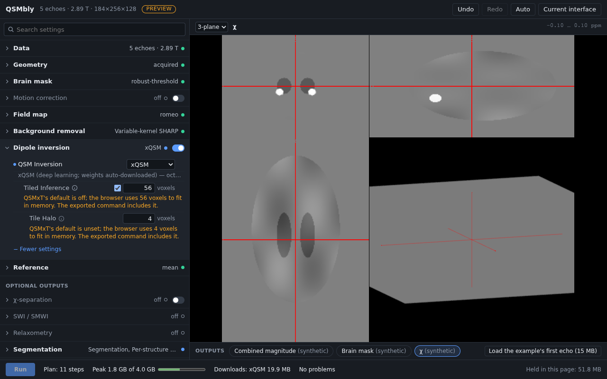</a>

As built in U2: the example loaded (the engine's facts with their sources), a run streaming into
the viewer, and after it with the plan drawer open:

<a href="ui-redesign/u2-data.png">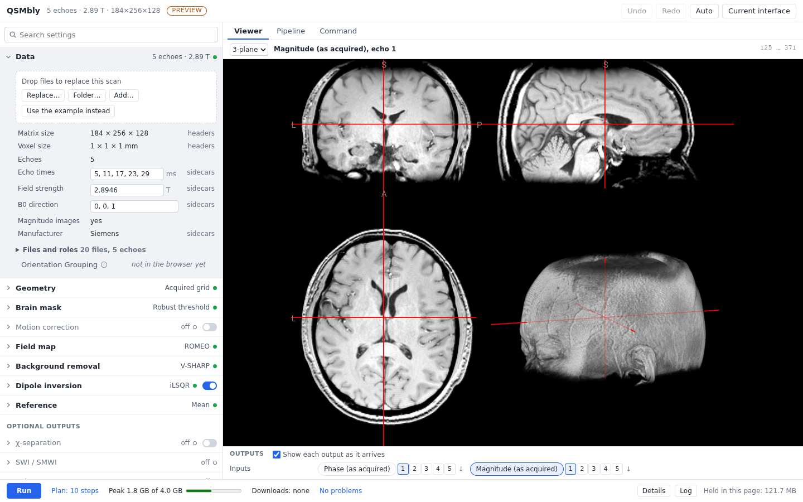</a>
<a href="ui-redesign/u2-running.png">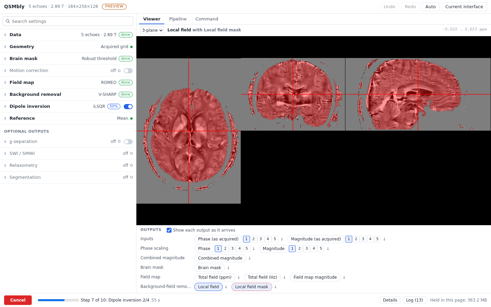</a>
<a href="ui-redesign/u2-done-drawer.png">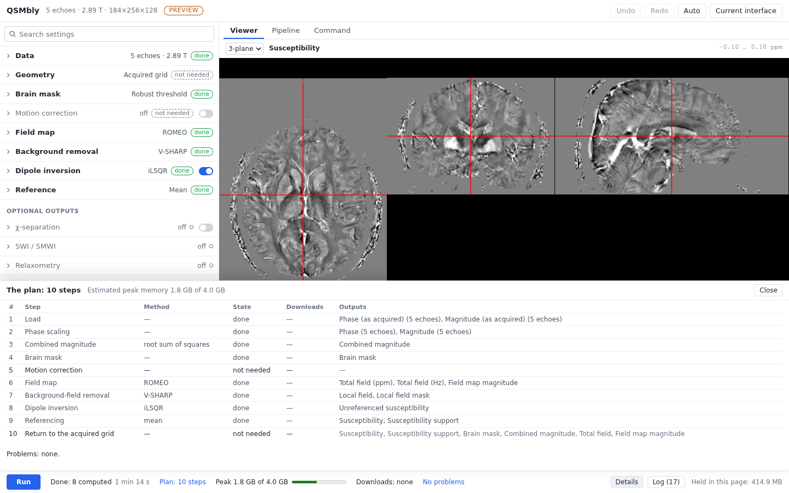</a>

As built in U4, on the example: after a run, the inversion changed to RTS marks Dipole inversion
"changed" and Reference "stale" (the engine's dry run), and the button reads "Re-run 2 steps";
after the re-run, χ of both runs side by side with their difference:

<a href="ui-redesign/u4-rerun-stale.png">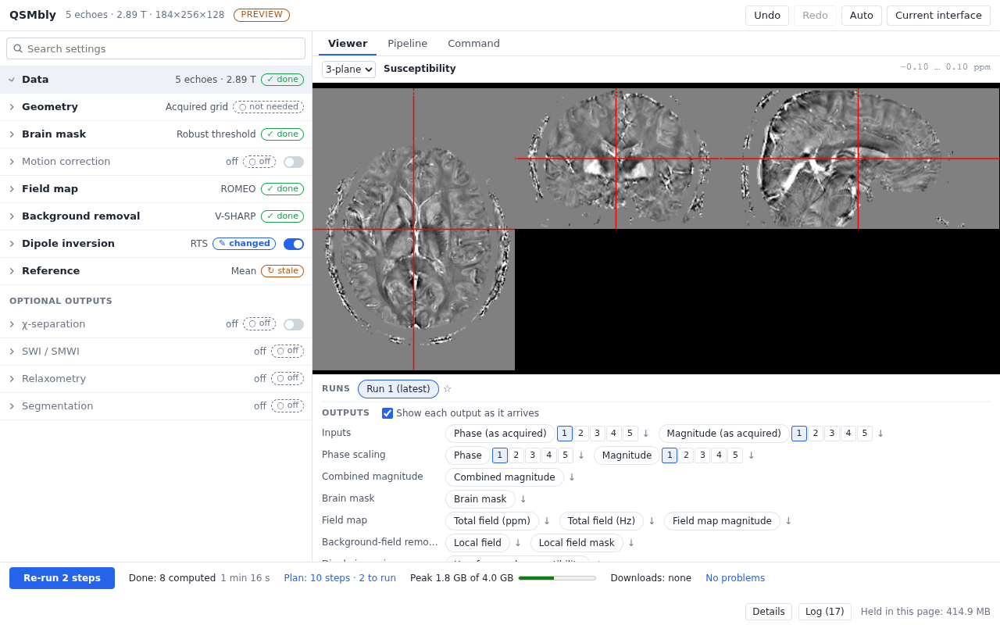</a>
<a href="ui-redesign/u4-rerun-compare.png">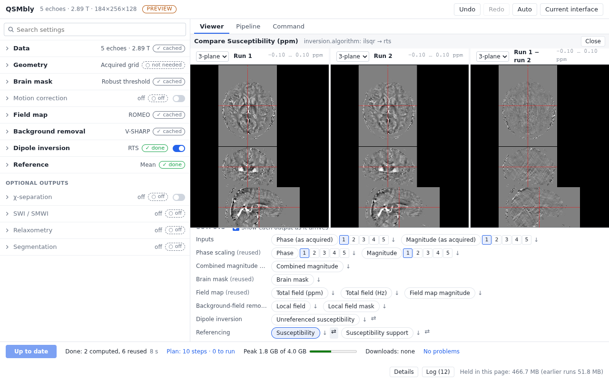</a>

The first sketch, with an inspector on the right, before the revision:
[proposed-workspace.png](ui-redesign/proposed-workspace.png).

### 3.4 Main flows

**A. First-time user with the example.**
1. Launch, then "Try the example".
2. The Data row fills in: 5 echoes, TEs from sidecars, 2.89 T, B0 direction. The run bar reads
   "Ready: 10 steps · peak ~2 GB · no downloads".
3. Run. The viewer follows: magnitude, then mask overlay, total field, local field, χ.
4. It ends on χ with a colorbar.
5. Hints offer the next steps: compare methods ("change Inversion, re-run 2 steps"), or export
   methods and command.

There is no mask step to discover, and nothing to configure.

**B. Researcher with their own data.**
1. Drop a DICOM folder, NIfTI and JSON files, or a BIDS folder.
2. If the drop holds several runs (BIDS, or DICOM with several series), pick one.
3. The Data step shows each file's role and the scan facts, with their sources (header,
   sidecar, typed). Missing facts are fields to fill ("No echo times: add JSON sidecars or type
   them"). Problems are attached to the files they concern (grid mismatch, unknown phase
   scaling).
4. Optionally import their QSMxT TOML. Migration warnings are shown.
5. Change settings in the pipeline column. The plan updates live: a deep-learning inversion adds
   "xQSM weights 21 MB", and HD-BET adds "123 MB, CC-BY-NC-4.0, ~1.9 GB peak (low-memory
   patch)".
6. Run.

**C. Tweak and re-run.**
1. After a run with the defaults, change Inversion from iLSQR to RTS.
2. The Inversion and Reference rows turn "stale", and the run bar says "Re-run 2 steps".
3. Run 2 reuses the mask, field and local field.
4. The outputs browser keeps run 1's χ. Compare shows both side by side with a linked
   crosshair, plus a difference map.
5. Changing a mask setting marks everything downstream of the mask instead.

**D. Export for a paper, or to rerun in QSMxT.**
1. Export shows:
   - the methods text (the same generator QSMxT uses, citing QSMbly), with copy as text or
     Markdown;
   - the command, `qsmxt run <bids_dir> …` with only the non-default flags, so it includes any
     browser-profile values;
   - the TOML;
   - the files.
2. "Download bundle" writes `config.toml`, `command.txt`, `methods.md` and the selected outputs
   with QSMxT's BIDS names and sidecars. If the mask was supplied, the bundle also has
   `derivatives/qsmbly/sub-…/anat/…_mask.nii.gz`, and the command has `--use-custom-masks
   qsmbly`.
3. A short "Reproduce in QSMxT" note names the QSMxT release this build runs.

### 3.5 Components

**Data panel.** Opening the Data row shows it under the row.

- **Run picker**, when the drop holds more than one run.
- **DICOM:** conversion progress per series, then a series table (description, TEs, and a type
  of magnitude, phase, real, imaginary or ignore), as in the TUI's DICOM mode. "Check protocol
  (dicompare)" lives here.
- **File roles:** echoes in order with their TEs. Rows can be dragged between roles, as today.
- **Scan facts table**: dims, voxel size, echoes and TEs, field strength, B0 direction,
  manufacturer, magnitude present, coils, real/imaginary. Each fact shows where it came from;
  missing or overridden facts are editable.
- **Problems**, attached to the file or fact they concern.

**Pipeline column.**

- Each row shows its name, a one-line summary of the current choice, and a status. The summary
  comes from the config through the schema, e.g. "V-SHARP" or "robust-threshold · two-pass".
- The statuses are: off, will run, changed, cached, running n%, done, stale, error, can't run.
- Opening a row shows its settings under it and points the outputs browser at that step's
  outputs. One row is open at a time.
- Keyboard: Tab moves between rows, Enter or Space opens one.

**Settings, inline.**

- A step renders its section's schema rows: label, control, units, help behind an ⓘ (also the
  hover title, so never hover-only) and the per-option help of a select, with its reference.
- **Basic / advanced.** Shows the basic rows by default. "+ n advanced" reveals the rest; the
  choice is remembered per step. Any value changed from its default is always shown, with a
  reset.
- **Ranges** are the schema's, enforced by QSMxT (exclusive bounds included). A value out of
  range is refused at the row, with the reason, and nothing is written.
- **Browser-default note** where the browser profile departs from QSMxT's native default:
  "QSMxT's default is off; the browser uses 56 voxels to fit in memory. The exported command
  includes it."
- **Supplied files** (custom mask, χ, R2, R2′, segmentation): a file input that puts the file in
  the store and names it as the derivatives tool `qsmbly`.
- **Search across all settings**, by label, help text, CLI flag or config path. Choosing a
  result opens its step and focuses the row.
- Undo/redo: the header's buttons, Ctrl+Z and Ctrl+Shift+Z (a field mid-edit keeps its own).
- The live command line (the TUI's command preview) and an advanced "Edit TOML" view (paste or
  import a QSMxT config) come with the bindings' command and TOML functions; until then
  settings are edited only here.

**Run bar and plan drawer.**

- The button has five states:

  | When | It reads |
  |---|---|
  | nothing is cached | **Run** |
  | some steps are cached | **Re-run n steps** |
  | weights are needed | **Download 21 MB and run** |
  | there is an error | **Fix 1 problem** (disabled; focus jumps to the problem) |
  | a run is in progress | **Cancel** |

- Chips: steps (to run / cached), the memory gauge (estimate against budget), downloads (bytes
  not yet cached, with licences), problems (errors / warnings).
- The drawer is the plan in full:

```
 #  Step           Algorithm       State      Peak    Downloads           Outputs
 1  Load           -               cached     -       -                   -
 2  Scale phase    -               cached     0.2 GB  -                   phase x5
 3  Magnitude      RSS + homog.    cached     0.3 GB  -                   magnitude
 4  Mask           robust-thresh.  cached     0.4 GB  -                   mask
 5  Field map      ROMEO, w. avg   cached     1.1 GB  -                   total field
 6  Background     V-SHARP         cached     0.9 GB  -                   local field
 7  Inversion      xQSM (tiled)    will run   2.3 GB  xQSM 20.9 MB (new)  raw chi
 8  Reference      mean            will run   0.1 GB  -                   chi
 9  T2*/R2*        ARLO            cached     0.5 GB  -                   T2*, R2*
10  Output space   -               -          -       -                   -
 Problems: none.   Notes: none.                                   [Download now]
```

- While running, it shows elapsed time and the current step's text from the engine (e.g.
  "Dipole inversion… iteration 34/100"). The pipeline rows show their progress, and an
  aria-live region announces step changes.
- Cancel keeps every finished step and drops only the one in progress. The next Run resumes
  from the cache.

**Viewer and outputs browser.**

- **Outputs are grouped by step, in run order.** Each shows its label and units, and is marked
  "new", "reused" or "stale".
  - Click to view.
  - Overlay: a mask goes over its source image at 40 % by default.
  - Compare opens a split view (A | B | A−B) with linked crosshairs (NiiVue `broadcastTo`).
- **Display presets by output kind**, from the engine's `Item` metadata:

  | Kind | Colormap | Window | Other |
  |---|---|---|---|
  | χ | gray | symmetric robust | ppm colorbar on |
  | fields | diverging | symmetric | |
  | magnitude | gray | robust | |
  | R2* / T2* | perceptual | fixed physiological range | |
  | segmentation | label LUT | — | |
  | masks | — | — | overlays |

- **Follow the run.** On by default during a run: each new output is shown as it arrives.
- **Toolbar:** layout, window with auto, colormap, colorbar, crosshair. Interpolation and
  screenshot go in an overflow menu. A crosshair readout gives the value and units for each
  visible layer.
- **Downloads:** one output as NIfTI with its QSMxT name and sidecar, or the selection as a zip.
- **Run history:** each run keeps its config snapshot and a diff against the current config
  ("inversion.algorithm: ilsqr → rts"). Outputs of earlier runs are kept within a memory budget,
  and can be pinned (§7, Q9).

**Mask builder** (inline in the Brain mask step). Its editor is built in U3; previews, hand
edits and uploads with alignment repair come in U5, on the engine's masking. As built in U3:

<a href="ui-redesign/u3-mask-recipe.png">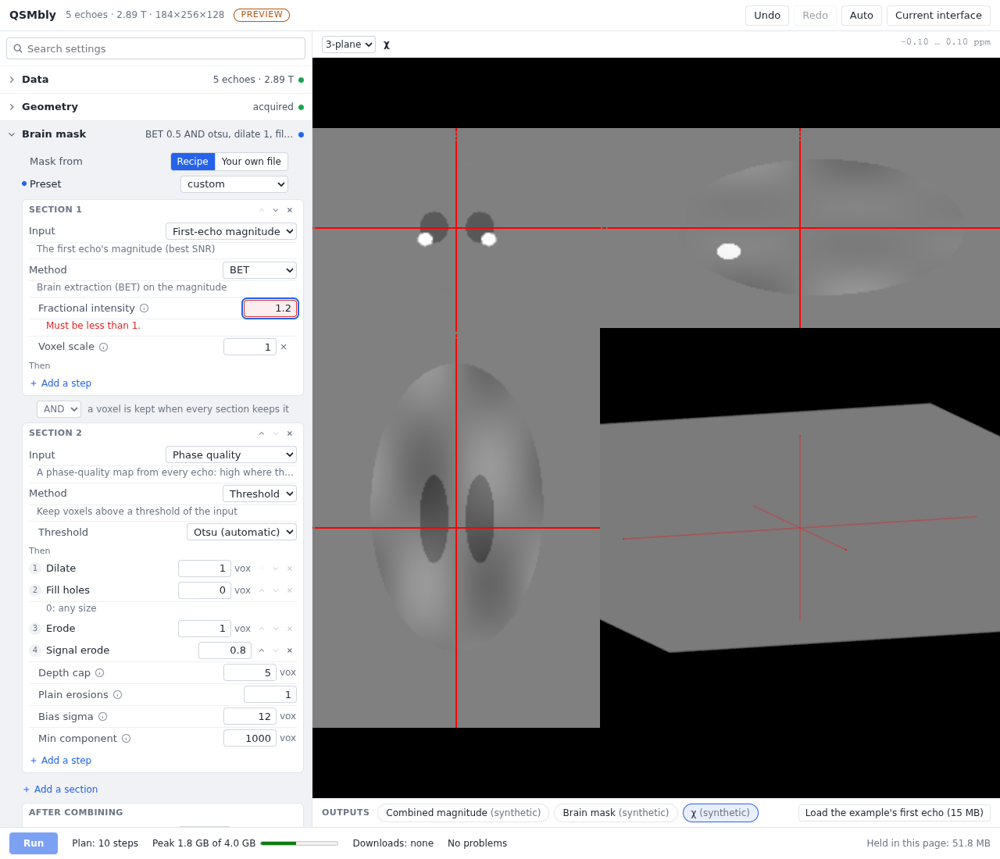</a>

The design, with the previews U5 adds:

```
MASKING                                  preset [robust-threshold v]
 Mask 1
   Input      [phase quality      v]     coverage 27 % of volume
   Generator  [threshold v]  (o) Otsu  ( ) value [0.42]  ( ) percentile
              |  histogram of the input, Otsu marked, value draggable  |
   1. dilate      [1]                                    [x]
   2. fill holes  [auto]                                 [x]
   3. erode       [1]                                    [x]
   + add step
 + add mask      combine [or v]
 [ ] Two-pass artefact reduction  (reliable mask: phase quality, Otsu)
 Preview: live for threshold and morphology; HD-BET / BET / RS2-Net / MindGrab on request
 [Edit by hand]   [Upload a mask]
```

- **The recipe is the config.** Edits go to `masking.sections`, `combine`, `refinements`,
  `two_pass` and `two_pass_sections`. The presets come from `mask_presets()`, and editing one
  switches the preset to "custom", as the TUI does.
- **Previews are the engine's.**
  - The section's input image (phase quality, combined magnitude) is computed once and cached
    as a store item.
  - Threshold and morphology then re-run on each change, debounced. Each op is one or a few
    passes over the volume, so a preview should take well under a second for 6 M voxels (to be
    measured in U5).
  - The viewer shows the mask over its input image.
  - Deep-learning and BET generators preview only on request, showing their download size,
    licence and estimated time.
- **Hand edits and uploads** freeze the result as a supplied mask, drawn with the existing
  brush. A banner explains: "This run uses a supplied mask. The export includes it as a BIDS
  derivative and adds `--use-custom-masks qsmbly` to the command." "Back to recipe" discards
  the edits.
- **Upload** keeps today's grid check and alignment repair as a loading step.

**Export panel.**

- Tabs: Methods (rendered, with copy as text or Markdown), Command, Config (TOML; download, or
  copy), Files (choose outputs), Reproduce (QSMxT version and steps).
- **Import:** TOML from QSMxT or an earlier qsmbly export, through `from_toml_migrating`, with
  its warnings shown.
- The header's Citations becomes "References for this run", taken from the methods text.

**Onboarding.** The landing page stays, and Launch opens the workspace. The empty state and the
run bar guide a first run, so the tour shrinks to a few optional steps.

**Log.** A collapsible console. It can be filtered by step, and copied. It is no longer the
main feedback channel. "Copy diagnostic report" gathers versions, the config TOML, the plan,
the error and browser details, and no image data.

### 3.6 Errors and warnings

| Kind | Where it shows | Effect |
|---|---|---|
| Requirement error (`plan.check.errors`) | Inline at the settings involved, a red mark on the pipeline row, the plan drawer | Run is disabled; the button reads "Fix n problems" |
| Requirement warning (an implied output that cannot be made) | Inline, amber, in the plan drawer | The run continues without that output |
| Input problem (missing TE, grid mismatch, unreadable file) | The Data panel, on the file or fact | Blocks the plan until resolved |
| Memory over budget | The gauge turns red, and the drawer names the step responsible and the settings that reduce it | Run asks for confirmation ("Run anyway"), since the estimate is conservative; above 75 % the gauge turns amber |
| Run failure | The failing row turns red and shows the engine's message, with "Show log" and "Copy diagnostic report" | Earlier outputs stay; Run resumes after a fix |
| Downloads | Listed in the run bar and the drawer, with sizes and licences | One click (the Run button) covers them |

There are no alert boxes and no messages that exist only in the console. Every message names
what to change.

### 3.7 Accessibility and responsiveness

- **Generated forms are accessible by construction.**
  - Every control has a label from the schema, and units in the label.
  - Help is attached with `aria-describedby`.
  - Errors use `aria-invalid` and `aria-errormessage`.
  - No help is hover-only.
- **The pipeline is a list of disclosure buttons** (`aria-expanded`). The run status is
  announced through `aria-live`.
- **Status never relies on colour alone.** Each status has an icon and text.
- **Contrast meets WCAG 2.2 AA** in both themes. Light and dark follow the system; today there
  is only dark.
- `prefers-reduced-motion` is respected.
- **Viewer shortcuts are documented**, and the readout is text.
- **Widths:**

  | Width | Layout |
  |---|---|
  | ≥900 px | the pipeline column beside the viewer |
  | <900 px | the viewer above the pipeline, with the run bar always visible |

- **Phones:** viewing results and small runs. The plan's memory check warns on devices that
  report little memory (`navigator.deviceMemory`, where available).

### 3.8 Design choices

| # | Choice | Options | Recommendation |
|---|---|---|---|
| D1 | Layout | A: today's sidebar and modals, restyled. B: a workspace with the pipeline beside the viewer. C: a wizard (Data → Mask → Settings → Run → Results). | **B**, with guided empty states for first-time users. A keeps the hidden ordering and the modal settings. C suits a first run, but makes tweak-and-re-run a chain of back buttons. |
| D2 | Settings surface | A: modal with tabs. B: an inspector on the right, bound to the outline. C: one long form with a table of contents. D: each step's settings inline under it, in the pipeline. | **D** (revised in U3 from B), plus search. B put choosing a step and editing it at opposite edges of the screen. A separates settings from results. C loses the link between a setting and its step and outputs. |
| D3 | Basic vs advanced | A: a `level` field in the schema. B: a separate simple mode. C: presets only. | **A**, plus mask presets. B builds the UI twice. C has nothing between a preset and 311 settings. |
| D4 | Mask | A: a manual pre-step (today). B: a recipe step with previews. C: B plus an escape to a supplied mask. | **C**. B alone has no answer for hand edits. |
| D5 | Runs and outputs | A: a re-run replaces the outputs (today). B: run history with compare, bounded by memory. C: one run; compare by downloading. | **B**. |
| D6 | Where volumes live | A: the engine's `MemoryStore` in the WASM heap. B: a JS store inside the worker. C: a main-thread store in SharedArrayBuffers. | **C** (§6.3). A holds float64 copies of every volume in the 4 GB heap: about 1.3 GB for the example, more than 6 GB at 0.6 mm. B loses everything on cancel. |
| D7 | Migration | A: big-bang. B: incremental, in place. C: a parallel app behind a flag. | **C** (§5). |
| D8 | Framework | §6.1 | Preact + htm + signals, no build step |

## 4. What the UI needs from the engine and bindings

Owners follow the parity plan: QSM.rs owns algorithms, the QSMxT engine owns wiring, policy and
text, and qsmbly owns the browser. The last column gives the owner, then the UI step from §5
that cannot ship without the item.

| # | Need, and why | Proposed shape | Owner · blocks | Issue |
|---|---|---|---|---|
| E1 | **Labels and metadata for steps and outputs.** The Plan JSON has no step names (`{"Mask":"Main"}`) while events use names (`"mask"`); `Item` has no label, units or kind | `Step { name, label, algorithm, algorithm_label, outputs: Vec<Item> }` in the plan, and `Item::meta() -> { label, units, kind, bids_name }` | QSMxT engine · U2 | [QSMxT#348](https://github.com/QSMxT/QSMxT/issues/348) (the rest after [QSMxT#347](https://github.com/QSMxT/QSMxT/pull/347)) |
| E2 | **Per-step state before running.** Show "cached / will run / stale" without running; send the worker only the inputs it needs | `plan_against(plan, config, facts, store) -> Vec<StepState>`, or a dry-run mode of `run`; each step lists the `Item`s it reads | QSMxT engine · U4 (U2 shows the plan without cache state) | [QSMxT#349](https://github.com/QSMxT/QSMxT/issues/349) |
| E3 | **A memory estimate for an in-browser run.** `estimate_peak_memory_bytes` models a disk-backed run (×1.3), leaves out RS2-Net, SynthSeg, R2PRIMEnet, the χ-separation nets, motion and resampling, and is not per step | Per-step working-set estimate (WASM heap only, inputs and outputs included); the step that sets the peak; a wasm32 budget constant | QSMxT engine (with QSM.rs figures for each net) · U2 | [QSMxT#350](https://github.com/QSMxT/QSMxT/issues/350), [QSM.rs#197](https://github.com/astewartau/QSM.rs/issues/197) |
| E4 | **Requirement problems in neutral words.** `Check` strings name CLI flags ("--do-swi needs magnitude images…") | `Problem { severity, output, settings: Vec<path>, message }`, with messages that name settings by schema label; the CLI renders flags, the GUI renders labels | QSMxT engine · U2 | [QSMxT#351](https://github.com/QSMxT/QSMxT/issues/351) (the rest after [QSMxT#347](https://github.com/QSMxT/QSMxT/pull/347)) |
| E5 | **The settings schema, with UI fields (4.1).** Render settings without restating them | Static: path, label, help (no key hints), per-option label/help/DOI, type (enum, bool, int, float, vec3, optional, text), units, min/max/step, native default, browser default, `level` (basic or advanced), tab and sub-tab, order and parent, CLI flag, `in_browser`. Dynamic: `settings_view(config, facts) -> rows { path, visible, forced: Option<reason>, error }`. Pruning hidden values ("a hidden value must not change the run", `src/tui/command.rs:267`) is an engine function | QSMxT engine · U3 | [QSMxT#352](https://github.com/QSMxT/QSMxT/issues/352) |
| E6 | **Config normalisation inside the engine.** `enforce_*_dependencies`, QSMART's default-mask swap and mask-spec validation live in the qsmxt binary and TUI, so a second front end would copy them | `PipelineConfig::normalised(&facts) -> (PipelineConfig, notes)`, used by `plan`, `generate_command` and `generate_methods` | QSMxT engine · U2 | [QSMxT#353](https://github.com/QSMxT/QSMxT/issues/353) |
| E7 | **A ScanFacts builder.** Each front end builds `ScanFacts` by hand (qsmxt in `src/pipeline/requirements.rs`) | `scan_facts(headers, sidecars, overrides) -> (ScanFacts, provenance, problems)` | QSMxT engine · U2 | [QSMxT#354](https://github.com/QSMxT/QSMxT/issues/354) (the rest after [QSMxT#345](https://github.com/QSMxT/QSMxT/pull/345)); the builder is [QSMxT#381](https://github.com/QSMxT/QSMxT/pull/381) |
| E8 | **Host steps in the engine (2.4).** `MemoryStore::host` fails for SWI, SMWI, T2*/R2*, R2/R2′, χ-separation, SynthSeg, statistics, motion, coil combination and real/imaginary input, and the resample back to the acquired grid. That makes any resampled run fail, including a DL inversion on oblique data. Front ends must not implement these themselves | Engine stages for each | QSMxT engine (QSM.rs algorithms) · U7 (SWI, T2*/R2* and resampling for parity with today); U8 for the rest | QSMxT PRs [QSMxT#341](https://github.com/QSMxT/QSMxT/pull/341)–[QSMxT#344](https://github.com/QSMxT/QSMxT/pull/344) |
| E9 | **Narrower cache invalidation.** The load key includes the configured axial-only algorithm list, so switching between a classical and a DL inversion clears every cached step, even on axial data | The load key depends on whether this scan is resampled, not on the algorithm list | QSMxT engine · U4 | [QSMxT#355](https://github.com/QSMxT/QSMxT/issues/355) |
| E10 | **Mask-preview semantics.** `run_step(mask)` overwrites `BrainMask` and invalidates downstream; mask inputs are not cached on their own | `stages::mask::preview(recipe, inputs, meta, upto) -> { mask, input_image, otsu }`, which leaves the store alone; section inputs (phase quality, combined magnitude) as cacheable items | QSMxT engine (QSM.rs: `resolve_masking_input`, `apply_mask_ops`, `otsu_threshold` exist) · U5 | [QSMxT#356](https://github.com/QSMxT/QSMxT/issues/356) |
| E11 | **A supplied mask in the command and methods text.** The methods text only says "Where available, brain masks were sourced from the '<tool>' BIDS derivatives…" | Wording for a mask supplied for this run, and a derivative path convention qsmbly can write (`derivatives/qsmbly/sub-*/anat/*_mask.nii.gz`) | QSMxT engine (qsmbly writes the file) · U5 | [QSMxT#357](https://github.com/QSMxT/QSMxT/issues/357) |
| E12 | **The browser profile (2.5), complete.** χ-separation nets have no patch field (`run_separation` hard-codes the defaults); HD-BET defaults to the full volume (9–13 GB) | `PipelineConfig::browser()`: DL tile size/halo, HD-BET low-memory patch, χ-sep and R2PRIMEnet patches, SynthSeg crop | QSMxT engine + QSM.rs (patch params for the χ-sep nets) · U2 | [QSMxT#358](https://github.com/QSMxT/QSMxT/issues/358), [QSM.rs#198](https://github.com/astewartau/QSM.rs/issues/198) |
| E13 | **A complete `plan.models`.** The plan can miss the recipe's models when a supplied mask is unreadable, and R2PRIMEnet when a MESE gives no R2; `StageStore::models` is synchronous | The plan lists every model that could be needed, or the run fails with a resumable "weights for X not provided" | QSMxT engine · U2 | [QSMxT#359](https://github.com/QSMxT/QSMxT/issues/359) |
| E14 | **Events and errors that cross the worker boundary.** `StageEvent<'a>` and `EngineError` are not serialisable, and errors carry no step id | The bindings convert them; errors carry a step name and kind | qsmbly bindings (or serde in the engine) · U2 | [qsmbly#159](https://github.com/astewartau/qsmbly/issues/159), done in [qsmbly#171](https://github.com/astewartau/qsmbly/pull/171) |
| E15 | **Logs with step context.** Stage internals log through the `log` crate, not `Observer::log` | A `log` backend in the bindings that forwards to the Observer, tagged with the current step | qsmbly bindings · U2 | [qsmbly#160](https://github.com/astewartau/qsmbly/issues/160), done in [qsmbly#171](https://github.com/astewartau/qsmbly/pull/171) |
| E16 | **Store precision.** qsmxt's file store round-trips every volume through float32 NIfTI between steps; `MemoryStore` keeps float64 | qsmbly's store keeps real volumes as float32. The parity test (3.7) runs the engine on a store with that precision | qsmbly (store), QSMxT engine (a documented contract) · 3.1/3.2 | [qsmbly#161](https://github.com/astewartau/qsmbly/issues/161); QSMxT side [QSMxT#346](https://github.com/QSMxT/QSMxT/pull/346) |
| E17 | **Progress for long steps.** Masking, unwrapping, TGV, iQSM, whole-volume DL, SWI and the DL mask nets report nothing; progress is not tagged with a step | Iteration or tile progress where it exists, forwarded with the step name | QSM.rs, QSMxT engine · U2 (not blocking) | [QSM.rs#195](https://github.com/astewartau/QSM.rs/issues/195), [QSMxT#362](https://github.com/QSMxT/QSMxT/issues/362) |
| E18 | **Cancellation.** None anywhere; only terminating the worker stops a run | Progress callbacks that can stop the run (`ControlFlow`), checked between steps and in iterative solvers | QSM.rs, QSMxT engine · Later. With the store outside the worker (D6), terminating is acceptable | [QSM.rs#196](https://github.com/astewartau/QSM.rs/issues/196), [QSMxT#363](https://github.com/QSMxT/QSMxT/issues/363) |
| E19 | **Output sidecars and names.** Downloads should match what `qsmxt run` writes | I/O-free sidecar JSON (units, `GeneratedBy`, references) and BIDS file names for each `Item` | QSMxT engine · U6 (not blocking) | [QSMxT#360](https://github.com/QSMxT/QSMxT/issues/360) |
| E20 | **Field-map inputs, if kept (Q5).** Total and local field maps are qsmbly-only inputs today | `ScanFacts` says a total or local field was supplied; the plan skips unwrap / bgremove; the command and methods text describe it | QSMxT · Q5 | [QSMxT#361](https://github.com/QSMxT/QSMxT/issues/361) |

The issues were filed in step U0. The critical path is E1, E3, E4, E6, E7 and E12 for U2, and E5 for U3. All of it is engine work
that does not depend on the UI, so it can start now. E5 belongs in 4.1's scope before 4.1
starts.

## 5. Phasing and migration

### 5.1 Migration options

| Option | For | Against |
|---|---|---|
| Big-bang on a long-lived branch | Simplest to reason about | Months without feedback, conflicts with 3.x work, one risky release |
| Incremental, in place | Users see progress | Every step must keep the sidebar/modal layout working, which is exactly the building-twice the parity plan avoids; the layout itself is the problem |
| **A parallel app in the same repo, behind a flag** | Built once, on the engine; deployed to staging from the start; today's UI unchanged until the switch | Two entry points for a while; both share the worker and bindings, so they cannot drift far |

**Recommendation: the parallel app.**

- The new UI is `next.html`, sharing `js/` modules, the worker and the bindings. It is deployed
  with every staging build. Once U2 works, today's UI on staging links to it ("Try the new
  interface").
- Today's UI gets only what keeps it working: the regression fixes in §1.3 item 3, and the
  parity plan's minimal 3.2 adaptation.
- The switch happens in one release, once the checklist in §5.3 passes. `?ui=classic` is kept
  for that one release, if it still runs on the engine at no extra cost, and then deleted.

### 5.2 Steps

| Step | Work | Needs | Parity-plan steps it covers | Size |
|---|---|---|---|---|
| U0 | Settle §7; file E1–E20 as QSMxT / QSM.rs issues; add E5's fields to 4.1's scope | — | — | S |
| U1 | Foundations: vendored Preact/htm/signals; the session store; worker protocol types (JSDoc, plus `.d.ts` from the bindings); a viewer component on NiiVue that loads typed arrays; a Playwright smoke harness on the example data (headless Chrome with SwiftShader runs NiiVue, as used for these screenshots); `next.html` on staging | none. Start now, on fixtures | — | M |
| U2 | The shell on the engine: Data panel (files → roles → ScanFacts); pipeline from `plan`; run bar and plan drawer (memory, models with sizes and licences, problems); run with streamed outputs; outputs browser; model downloads before the run; the store (D6); the "Edit TOML" view as the interim settings UI | 2.3 merged; 3.1; engine side of 3.2; E1, E3, E4, E6, E7, E12–E16 | **3.6** | L |
| U3 | Settings from the schema, inline in the pipeline column (basic/advanced, ranges, search, browser-default notes, supplied files, undo and its shortcuts), and the mask builder's recipe editor. The live command and TOML import/export follow with the bindings' command and TOML functions | 4.1 with E5; 2.5 | **4.2** | M |
| U4 | Re-run from here: stale markers, the "Re-run n steps" button, run history, compare view | E2, E9 | **3.5** | M |
| U5 | Mask builder on the engine: previews of the recipe; hand edits and uploads (with alignment repair) become a supplied mask; derivative export | E10, E11 | **3.4** | M |
| U6 | Export panel and bundle (methods, command, TOML, outputs with sidecars) | E19 (optional) | — | S |
| U7 | Switch: the new UI becomes `index.html#app`. Delete the old UI and everything only it used: `MaskController`'s numerics, `PipelineSettingsController`, `ConfigBridge`, the settings HTML, the old worker paths and JS numerics | §5.3 checklist; E8 for SWI, T2*/R2* and resampling | rest of **3.3** | M |
| U8 | Phase 5 features as the engine gains them (2.4): SWI/SMWI, relaxometry, χ-separation, SynthSeg with region reference and a statistics table, motion, real/imaginary, uncombined coils. Per feature: display hints and the odd widget | 2.4 | phase 5, UI side | S per feature |

Sizes: S is one PR, M a short series of PRs, L several series.

Status (2026-10-17): U2 is qsmbly #171 (the Data step: files, roles, the engine's scan facts,
DICOM) and #172 (runs: the run worker, streamed outputs, the outputs browser, cancel and
progress, the plan drawer and model downloads). Since then, E4 (requirement problems in neutral
words) has merged as QSMxT #385, E6 (config normalisation) as QSMxT #399, and E12 (the χ-separation
patch sizes) as QSM.rs #208 and QSMxT #401, for U8 (below). Still open: a per-step memory estimate for the browser (E3);
until then, the run bar shows the engine's estimate for a disk-backed run. Also still open: the
plan's models when a supplied mask is unreadable (E13).

U4 is qsmbly `next-rerun`, on QSMxT #388 (E9) and #389 (E2, `run::dry_run`): row statuses and the
"Re-run n steps" button from the engine's dry run over the page's record and volumes, run history
(the latest two runs plus pinned ones, with the memory only they hold), and the compare view.

U5 is qsmbly #175, on QSMxT #390 (E10, E11). The mask builder previews its recipe through the
engine (`run::preview_mask`, the run's own masking): the preview is the run's mask bit for bit,
and the section images are kept between previews. On 6.3 M voxels natively, a threshold or
morphology edit takes 70–115 ms. Building the phase-quality image once takes about 0.8 s. The
viewer shows the preview over its input, with Otsu's threshold. A mask edited by hand with the
viewer's brush, or uploaded and repaired with the axis flips, becomes a supplied mask. It is
downloaded as `derivatives/qsmbly/sub-*/anat/<run>_mask.nii.gz`, and the methods text of the run
says the brain mask was supplied.

Order and parallelism:

- **U1 starts now.** U0's issues go to QSMxT now as well, because E1, E3, E4, E6, E7 and E12
  are on U2's critical path and E5 is on U3's. They fit the 2.3–2.5 work already under way.
- **U2 follows 3.1/3.2.**
- **U3 follows 4.1.** It would help to start 4.1 right after 2.3, rather than after phase 3. 4.1
  is QSMxT work and does not wait for the UI.
- **U4 and U5 can run in parallel after U2.**
- **U6 is small.**

Status (2026-10-19): U8 is a stack of five PRs, each on the one before:

1. qsmbly #181: SWI/SMWI and relaxometry, how the viewer draws each kind of output, and the settings the engine turns on.
2. #182: segmentation, region referencing and the per-structure statistics table.
3. #183: motion correction and its report.
4. #184: real/imaginary input (with GE's phase sign), uncombined coils, and a MESE for R2.
5. #185: χ-separation, classical and deep-learning.

They are pinned to QSMxT main e426923. That commit has QSMxT #399 (E6, config normalisation in the engine), #396 (`ScanInputs` for real/imaginary parts, coils and a MESE), and #401 (the χ-separation patch sizes, E12), on QSM.rs #208. Every feature's settings come from the schema. Every output streams to the viewer and lands in the bundle under QSMxT's name. Tables and reports, which the engine keeps in its record, are outputs too.

The deep-learning steps fit the 4 GB heap on the example data (184×256×128, 5 echoes):

- SynthSeg in its 96³ window peaks at 2.40 GB.
- R2PRIMEnet at 128×128×64 takes the heap from 1.09 to 1.64 GB.
- χ-sepnet at 128×128×64 takes the heap from 1.78 to 2.34 GB.
- SUSEP-Net at 96×96×64 takes the heap from 1.96 to 3.09 GB, in 17 minutes. That is the highest peak of any feature.

Open after U8:

- E3: a per-step memory estimate for an in-memory run. The plan drawer already records each step's heap after a run.
- E13: the models of a mask recipe when a supplied mask is unreadable. The R2PRIMEnet half is done: the plan now lists it whenever R2′ may be predicted.
- QSMxT #397: motion correction switched on for a scan it cannot correct says nothing.

### 5.3 Switch checklist

The new UI must cover what today's UI does:

- [x] NIfTI/JSON and DICOM loading, with reassignment and the example data (U2). Real/imaginary
  parts, uncombined coils and MESE echoes take roles too (U8).
- [ ] dicompare.
- [x] Every setting today's UI has (through the schema) (U3).
- [x] Mask presets, recipe editing and previews (U3, U5).
- [ ] BET, HD-BET and RS2-Net.
- [x] Mask upload with alignment repair, and hand edits (U5).
- [x] Run, cancel and progress (U2).
- [x] Streamed outputs and downloads (U2, U6), with tables and reports (U8).
- [x] SWI and T2*/R2* as engine steps (U8, #181), and the rest of phase 5: SMWI, R2/R2′,
  χ-separation, segmentation with statistics, motion correction, real/imaginary and coil input.
- [x] Command, methods and TOML (U3, U6).
- [ ] Field-map inputs, as Q5 decides.
- [ ] The mobile layout.
- [ ] Playwright flows and the parity CI (3.7) green.

### 5.4 Not building anything twice

- No features in today's UI; only fixes that keep it running until U7.
- No hand-written settings forms in the new UI.
  - Until U3, settings are changed through presets (mask presets come from the engine) and the
    "Edit TOML" view.
  - The TOML view is a permanent feature (pasting a QSMxT config), not throwaway work.
- The mask builder is built once, on engine masking (U5). Until then the new UI offers mask
  presets and an upload.
- The plan (3.6) and re-run (3.5) exist only in the new UI.
- The worker relay (3.2) is written once, for the engine. Today's UI adapts its message
  handling to it, and nothing more.

### 5.5 Risks

| Risk | Effect | Mitigation |
|---|---|---|
| The engine needs (E1, E3, E4, E6, E7, E12) land late | U2 waits | U1 builds on fixtures (a recorded plan, events and volumes); most of the engine items are small and can go into the 2.3–2.5 PRs |
| 4.1 (the schema) grows large or slips | U3 waits | The "Edit TOML" view and engine presets keep the new UI usable; the schema can land tab by tab |
| The memory estimate is wrong for the browser | Runs blocked needlessly, or out-of-memory failures | "Run anyway"; record the WASM heap's high-water mark per step in the parity CI and compare it with the estimate |
| SharedArrayBuffer is unavailable (Safari) | No zero-copy store | Fall back to transferring copies; same behaviour, more copying |
| Upgrading NiiVue from 0.57 breaks today's UI | Regressions in the old UI | Load the new NiiVue only in `next.html` until the switch |
| Two entry points diverge | Confusion on staging | Shared worker, bindings and modules; the old UI is frozen except for fixes |

## 6. Technology

### 6.1 UI framework

Constraints that shape this choice:

- **Size.** Today: about 13,300 lines of JS (plus 3,900 of tests), 3,600 of CSS and 2,950 of HTML.
  About 6,000 lines go away with the engine (§1.4). The new UI's own code (pipeline, settings
  renderer, mask editor, run bar, outputs browser, store) is a similar amount of new code.
- **No build step today.** The site is static ES modules on GitHub Pages, with CDN libraries
  under SRI and vendored dcm2niix and nifti-js.
- **Cross-origin isolation** through the service-worker shim.
- **The UI is dynamic.** It re-plans on every edit, renders forms from the schema, updates many
  rows during a run, and keeps undo history.
- **The audit's bugs were mostly state ↔ DOM drift.** #55 (14 mirrored mask fields), #58, #61
  (a "Brain Mask" button for a mask that does not exist) and #39 (a run gate never fed).

| Option | For | Against |
|---|---|---|
| Vanilla JS with a small store (today's approach) | No dependencies | Every view updates the DOM by hand, which is where the drift bugs came from; a schema renderer plus live plan states means a lot of imperative code |
| **Preact + htm + @preact/signals, vendored** | Components and declarative rendering without a build step (htm tagged templates); signals update only the rows that change during a run; about 10 KB; widely known | A new dependency (pinned and vendored, so offline and SRI-safe) |
| Lit (web components) | Standards-based | Shadow DOM fights a global theme; app-wide state needs its own store anyway |
| Svelte / React / Vue with Vite and TypeScript | The best tooling | Adds a bundler and a JS build to a repo that already has a Rust build; a larger dependency surface |

**Recommendation: Preact + htm + signals, vendored under `vendor/`.**

- Type safety comes without a bundler: JSDoc types checked by `tsc --noEmit --checkJs` in CI,
  against `.d.ts` files generated from the engine's serde types (`tsify` in the bindings).
- A renamed config field or event variant then fails CI instead of failing in a user's
  browser.

### 6.2 Viewer

Keep NiiVue and upgrade it from 0.57.

- **Load volumes from typed arrays** (`NVImage` from data and header). Today the worker encodes
  a NIfTI per stage and the main thread decodes it again.
- **Compare views** use one NiiVue instance per pane, synced with `broadcastTo`.
- **The brush tools** stay on NiiVue's drawing layer.

Alternatives:

- cornerstone3D: DICOM-centred and heavy.
- Papaya: unmaintained.
- A custom 2D slice viewer: would re-implement overlays, colormaps, drawing and 3D.

### 6.3 State, store and workers

- **Session store.** Signals hold the inputs, facts, config (with an undo stack), plan, runs and
  UI state. The plan is recomputed through the worker on every config or facts change (it is
  pure and cheap), debounced to the next frame.
- **Volume store (D6).**
  - The main thread owns every volume as float32 in a SharedArrayBuffer, keyed by `Item`, along
    with the recorded step keys.
  - At the start of a run the compute worker gets the index and buffer handles; sharing them
    costs no copy.
  - The worker's `StageStore` implementation:
    - reads by copying into the WASM heap;
    - writes by allocating a new SharedArrayBuffer and posting its handle.
  - The viewer copies only the volume it displays.
  - Results:
    - The WASM heap holds only the step being computed.
    - Cancelling (terminating the worker) loses only the step in progress.
    - The worker can be recycled after a run, since the WASM heap never shrinks.
    - float32 matches QSMxT's intermediates (E16).
  - Where the page is not cross-origin isolated (Safari, which lacks the `credentialless`
    policy the site relies on), it falls back to transferring copies.
- **Memory budget.**
  - The gauge compares the plan's per-step estimate (E3) with the 4 GB heap.
  - A separate store meter shows the bytes held, with "discard earlier runs".
  - Earlier runs keep only the outputs that differ from the current run, unless pinned.
- **Persistence.**
  - The config and UI preferences go in `localStorage`; settings survive a reload.
  - Data does not persist in the first version (§7, Q10).
- **Workers.**
  - One compute worker on the engine bindings, with the DL bundle loaded only when `plan.models`
    is non-empty, as 3.1 intends.
  - DICOM conversion and dicompare stay where they are.

### 6.4 Testing

- **Unit tests** (Jest + jsdom): the schema renderer is tested against the real schema JSON
  exported from the bindings. Every schema row must render, and every control must have a
  label.
- **Flows** (Playwright on the built site): load the example, run the defaults, change the
  inversion and check that only 2 steps re-run, export, and check the command. CI already
  builds the WASM bundle.
- **Accessibility:** axe-core checks inside the Playwright flows.

## 7. Decisions

Decided 2026-10-16: each question below is answered as recommended.

1. **Layout.** Adopt the three-pane workspace (outline | viewer | inspector, plus the run bar)
   rather than restyling today's sidebar or building a wizard?
   *Decided: yes. Revised in U3: the settings sit inline in the pipeline column, beside the
   viewer, with no inspector (§3.3); signed off from a clickable mockup.*
2. **Migration.** Build the new UI as a parallel app (`next.html` on staging), give today's UI
   fixes only, and switch in one release once the checklist passes?
   *Decided: yes.*
3. **First engine-based release.** Should it wait for the new UI?
   *Decided: aim for the new UI. If the checklist is not met when QSMxT releases the
   engine, ship today's UI on the engine and offer the new one as a preview.*
4. **Framework.** Adopt Preact + htm + signals (vendored, no build step) with JSDoc types
   checked against `.d.ts` generated from the engine?
   *Decided: yes.*
5. **Field-map inputs** (total and local field maps), which QSMxT cannot take today. Make them
   a QSMxT input mode (E20), keep them qsmbly-only and marked not reproducible, or drop them?
   *Decided: add them to QSMxT. The new UI leaves them out until QSMxT has them.*
6. **Supplied masks.** Export hand-edited or uploaded masks as a BIDS derivative used through
   `--use-custom-masks qsmbly`, with methods wording for a supplied mask (E11)?
   *Decided: yes.*
7. **Schema scope.** Should 4.1 carry `level` (basic/advanced) and a browser default per
   setting, and should visibility be an engine function (`settings_view`) rather than a
   condition language? This changes what the TUI can use too.
   *Decided: yes to both.*
8. **Requirement messages.** Make the engine's problems front-end-neutral: structured, naming
   settings by path, with the CLI rendering flags and the GUI rendering labels (E4)?
   *Decided: yes.*
9. **Run history.** Keep earlier runs' outputs for comparison, bounded by a memory budget, with
   the latest two kept by default and pinning available?
   *Decided: yes.*
10. **Persistence.** Keep loaded data and outputs across page reloads, on disk via the browser's
    origin-private file system?
    *Decided: not in the first version. Settings persist; data persistence can come later
    as an explicit opt-in, since it keeps subject data on disk.*
11. **Presets.** Add pipeline presets beyond the mask presets (e.g. "fast", "deep learning")?
    *Decided: only if QSMxT gets them too, defined in the engine.*
12. **Deep-learning licences.** Is listing each model's licence next to its download size enough
    (e.g. HD-BET, CC-BY-NC-4.0), or should non-commercial models need an explicit
    acknowledgement?
    *Decided: listing is enough. The download is the Run click, as today's HD-BET dialog
    does.*
